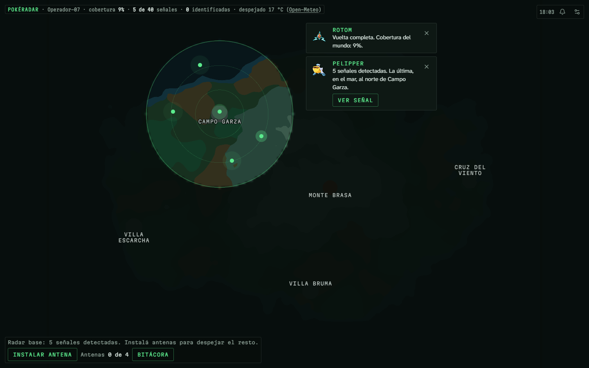
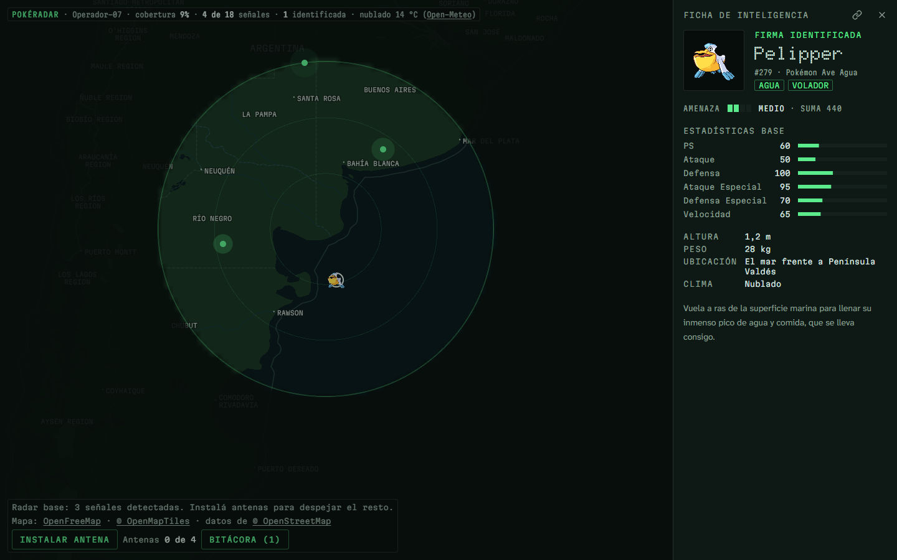
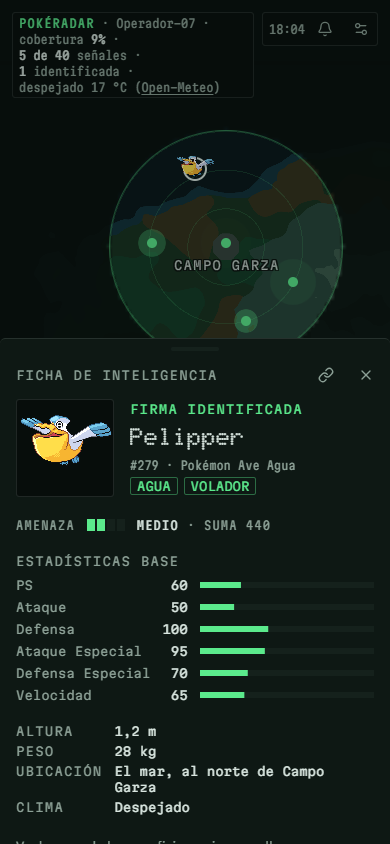

# PokéRadar

Sala de monitoreo: un mapa con un mundo generado, señales que pulsan como en un radar y una ficha de inteligencia para
identificar cada una con datos reales de PokéAPI.

- **Producción:** https://pokeradar-nine.vercel.app
- **Consigna:** [docs/consigna.md](docs/consigna.md) · **Concepto completo:** [docs/concepto.md](docs/concepto.md)

<p>
  
</p>
<p>
  
  
</p>

## Cómo correrlo

Con Node 24, el que usa la CI (el proyecto no fija otro), y pnpm 10.34.1, el del campo `packageManager` de
`package.json`:

```bash
pnpm install     # dependencias
pnpm dev         # servidor de desarrollo, en http://localhost:3000
pnpm build       # build de producción
pnpm start       # sirve el build
pnpm lint        # ESLint
pnpm typecheck   # next typegen && tsc --noEmit
```

No hacen falta claves ni `.env`: el código no lee variables de entorno, y PokéAPI, Open-Meteo y OpenFreeMap son
públicas y sin clave. Sí hace falta red: el dataset de especies se pide a PokéAPI en el servidor, en el build (o al
abrir la página con `pnpm dev`).

**Para probarlo rápido**, estas direcciones, relativas a la app:

- `/`: la primera vez, el inicio de turno; después, la sala. El radar base da su vuelta y detecta 5 de las 40 señales.
- `/?p=4`: la sala con la ficha de Charmander abierta y la señal identificada, sin pasar por el inicio de turno.
- `/?noche=1`: la noche a cualquier hora (`?noche=0` la apaga).
- `/?modo=real`: el mapa real de Argentina, con 18 señales; el radar base, en Viedma, detecta 4.
- `/?modo=real&p=279`: el mapa real con la ficha de Pelipper, en el mar frente a Península Valdés.

Con el foco en el mapa: A instala una antena (flechas y Enter la ubican con teclado), B abre la bitácora, M silencia y
? abre los ajustes con la lista de atajos.

## Concepto y Narrativa

Sos el operador de turno de un centro de monitoreo. En el mapa aparecen señales sin identificar; al tocar una, la cámara
vuela hasta ella, el sistema "analiza la firma" y abre la ficha de inteligencia del Pokémon: tipos, estadísticas base,
nivel de amenaza, altura, peso y el lugar donde se detectó. La señal identificada pasa a mostrar su sprite.

La idea la saqué del producto de DataInt (monitoreo, alertas, niveles de amenaza) y de la propia PokéAPI, donde el Poké
Radar existe como ítem y como condición de encuentro. Quise que los requisitos de la consigna fueran parte del relato: el
skeleton es "Analizando firma…", el error es "Señal perdida" con "Reintentar", y los marcadores son pulsos de radar.

Para quien lo usa, la metáfora hace de instrucciones: una señal que pulsa se toca, la espera es el sistema analizando y
un error es una señal que se perdió y se puede volver a buscar. Cada estado dice qué está pasando con palabras de la
historia, en lugar de un spinner o un mensaje genérico.

En el modo por defecto, el mundo no es un mapa real: es una isla generada con ruido y semilla (151), con nueve biomas,
uno por cada hábitat de PokéAPI (el mar, la cueva, la ciudad; el volcán es el de las especies raras). Cada una de las
40 señales es una especie distinta, ubicada en su hábitat. El modo híbrido (`?modo=real`) lleva el radar a Argentina
entera: 18 de esas especies, cada una en un lugar real de su hábitat, como las Cataratas del Iguazú, la pampa del
Salado o el mar frente a Península Valdés.

**El MVP de la consigna:**

| Requisito                                              | Cómo lo cumplí                                                                                                                                                                                                                                                                                                     |
| ------------------------------------------------------ | ------------------------------------------------------------------------------------------------------------------------------------------------------------------------------------------------------------------------------------------------------------------------------------------------------------------ |
| Mapa interactivo con marcadores propios y cámara suave | MapLibre GL JS con el mundo generado como única fuente (sin tiles externos) en el modo por defecto; el modo híbrido (`?modo=real`) usa las teselas de OpenFreeMap; 40 señales con pulso de radar que se transforman en el sprite animado al identificarlas; `flyTo` con padding para que la ficha no tape la señal |
| Datos reales y panel de detalle                        | Dos pedidos a PokéAPI (`/pokemon` y `/pokemon-species`), validados; ficha al costado en desktop y abajo en mobile; skeleton del tamaño final y error con reintento                                                                                                                                                 |
| Animaciones con propósito                              | Pulso de las señales, "Analizando firma…" que se descifra, entrada de la ficha, barras de estadísticas que crecen, entrada del sprite; todo apagado con movimiento reducido, el de `prefers-reduced-motion` o el elegido en los ajustes (la cámara usa `jumpTo`)                                                   |

Accesibilidad: cada señal es un `<button>` con `aria-label` ("Señal sin identificar en el volcán de Monte Brasa", y
después "Shuppet en la ciudad de Cruz del Viento"), foco visible, Tab entre señales de norte a sur, Esc cierra la ficha
y el foco vuelve a la señal.

**Lo que se suma al MVP:**

- **Tipografía propia:** Martian Mono para el sistema y los datos, Atkinson Hyperlegible Next para leer y Doto, de
  matriz de puntos, solo para el nombre identificado y "Señal perdida".
- **Nombres de lugares:** las cuatro ciudades, el volcán y los dos lagos tienen nombres inventados, elegidos con la
  semilla, que el mapa dibuja con Martian Mono. Cada señal se nombra desde la ciudad o el volcán más cercano ("la
  llanura, al noreste de Campo Garza"), en su `aria-label` y en la ficha.
- **Niebla y radar base:** el mundo arranca cubierto. La niebla tapa los colores del terreno y las señales, no su
  forma: encima va la carta, con la costa y las curvas de nivel en el color del HUD. Desde Campo Garza, la ciudad
  más cercana al centro, un haz da una vuelta, despeja un círculo, el 17 % de la isla, y se apaga. Solo las señales
  que detecta existen como botones: aparecen con un ping, Pelipper las avisa y el HUD las cuenta ("5 de 40
  señales"). Al terminar la vuelta, el panel de abajo dice cuántas detectó y cómo seguir: "Radar base: 5 señales
  detectadas. Instalá antenas para despejar el resto." Con movimiento reducido, el círculo se despeja de una vez.
- **Antenas:** el operador instala hasta cuatro, con el mismo alcance que el radar base, donde quiera dentro del
  mundo. Con "Instalar antena" o la tecla A, un clic o un toque en el mapa la ubica; con teclado, las flechas mueven
  una mira y Enter la instala ahí. Cada antena da su vuelta, y el panel dice cuántas señales detectó o que no había
  ninguna en alcance. Esc cancela. La A vale con el foco en el mapa o en el panel de las antenas. Con las cuatro se
  llega como mucho a 38 de las 40 señales: cualquier combinación deja al menos dos afuera.
- **Inicio de turno y arranque:** la primera vez, el operador elige un nombre en clave, el color del HUD (verde,
  ámbar o cian), la intensidad visual y el sonido, con "Saltar" siempre visible; mientras tanto el mapa carga por
  detrás y el radar espera. La carga la cuenta Rotom con sus pasos reales: "Calibrando radar…", "Conectando
  satélites…", "Cobertura: 0%".
- **HUD de esquinas:** arriba a la izquierda, el operador, la cobertura, las señales detectadas, las identificadas y
  el clima; arriba a la derecha, la hora, la campana y los ajustes del turno (nombre, color, intensidad visual,
  sonido, los atajos y el cambio de zona), donde también están la semilla y la huella del mundo. Cada esquina va en
  una caja con borde, como el panel de abajo, con los valores en claro y las palabras apagadas. La cobertura cuenta
  el mundo entero, mar incluido, y no solo la isla: después del radar base marca 9 %, y con las cuatro antenas en los
  puntos de las 38 señales, 44 %.
- **Tripulación:** los avisos los dan Pokémon, con su sprite. Pelipper avisa los avistamientos en un solo aviso que
  suma las señales mientras sigue abierto, con "Ver señal" para abrir la última; Rotom, la cobertura después de cada
  vuelta; Porygon, el análisis de cada señal identificada, con su nivel de amenaza (alto o crítico es una alerta); Xatu,
  el pronóstico del clima, y Noctowl, la guardia nocturna. Van arriba a la derecha y se cierran solos 5 s después del
  último cambio. F6 lleva el foco a ellos, y la campana los silencia: las detecciones van entonces solo al lector de
  pantalla, y Xatu y Noctowl, si no habían hablado, hablan al reactivarlos. Chatot, el sexto tripulante del concepto,
  quedó afuera.
- **Variocolor:** cada señal tiene una chance en 64, decidida con la semilla, de ser variocolor (shiny). Identificada,
  muestra ese sprite en el mapa y en la ficha, y Porygon da un aviso crítico. Con la semilla del mundo no sale ninguna
  de las 40 (medido), así que `?shiny=<id>` fuerza una para verla: `?p=4&shiny=4` abre Charmander variocolor, ya
  identificado.
- **Clima:** el clima real de Viedma (Río Negro), de Open-Meteo, va en el HUD con un enlace a Open-Meteo, como pide su
  licencia. Xatu lo pronostica al empezar el turno, con los tipos que potencia; de noche, el cielo despejado no
  potencia nada, porque no hay sol. Una señal identificada de uno de esos tipos lleva una flecha en su sprite; en la
  ficha, el tipo va lleno y con la flecha, y la fila Clima dice "potenciado". No cambia qué señales hay. Si Open-Meteo
  no responde, el HUD dice "clima sin datos" y Xatu no habla.
- **Día y noche:** con la hora del operador, de 20:00 a 6:59 es de noche: el mapa se oscurece, Noctowl toma la guardia
  y se potencian Fantasma y Siniestro, con las mismas marcas que el clima. Cambia también con la página abierta, al
  pasar el minuto. `?noche=1` y `?noche=0` la fuerzan, para verla a cualquier hora.
- **Bitácora e informe:** el botón Bitácora, abajo a la izquierda, lista lo identificado en el turno, de lo más nuevo
  a lo más viejo, con hora, amenaza y lugar; "Ver" abre la ficha de esa señal. El informe se baja como CSV (con BOM,
  para que Excel lea los acentos). La bitácora vive en memoria: recargar la página empieza otra.
- **Fin de turno:** un resumen con la duración, la cobertura, las señales detectadas e identificadas, las anomalías
  (variocolor), la amenaza más alta y las antenas. "Empezar otro turno" vuelve a cubrir el mundo, en la misma zona.
- **Compartir una señal:** con la ficha abierta, la URL dice cuál es (`?p=4`, Charmander; en el mapa real,
  `?modo=real&p=279`, Pelipper), y el botón del enlace la copia. Ese enlace abre la sala con la señal identificada y
  saltea el inicio de turno. Un número que no está en el mundo, o algo que no es un número, lo avisa Rotom.
- **Intensidad visual:** en el inicio de turno y en los ajustes, "Como el sistema" (de entrada), "Completa" o
  "Reducida". Como el sistema sigue a `prefers-reduced-motion`, también si cambia con la página abierta; elegida, gana.
  Reducida apaga el haz y el barrido (el radar despeja de una vez), el pulso de las señales, el texto que se descifra,
  el sprite animado y las transiciones, y la cámara salta en lugar de volar. Las animaciones propias del mapa (las
  flechas, el +/−, el doble clic y la inercia) toman una elección nueva al recargar.
- **Sonido:** apagado por defecto; se prende en el inicio de turno o en los ajustes. Un ping de radar hecho con Web
  Audio, sin archivos, en cada detección, y el grito del Pokémon (`cries.latest` de PokéAPI) al identificarlo. La
  campana del HUD silencia también el sonido.
- **Atajos de teclado:** A instala una antena, B abre la bitácora, M silencia y ? abre los ajustes, que listan los
  atajos. Valen con el foco en el mapa o en el panel de abajo, para no dispararse al dictar con la voz (WCAG 2.1.4).
- **Mapa real (modo híbrido):** `?modo=real` lleva la sala a Argentina entera, con el radar, la niebla y las antenas,
  y el radar base en Viedma. Las señales son 18 de las 40 especies del mundo, sorteadas en el build dentro de 46 zonas
  reales según su hábitat (el Mar Argentino, las Cataratas del Iguazú, la pampa, la Cueva de las Manos, ocho
  ciudades), con la misma semilla y la misma separación; cada zona se comprobó contra las teselas que dibuja el mapa
  ([docs/decisiones.md](docs/decisiones.md), "Las señales del mapa real"). El mapa son las teselas vectoriales de
  OpenFreeMap, sin clave, con los colores del HUD. Los biomas inventados no se dibujan, y cada señal se nombra por su
  zona: "Señal detectada en las Cataratas del Iguazú". Se entra y se sale con el enlace del inicio de turno o de los
  ajustes, que empieza otro turno. La atribución del mapa va en el panel de abajo.

## Arquitectura y Stack

| Pieza             | Elección                                                                 | Por qué                                                                                                                                                                                      |
| ----------------- | ------------------------------------------------------------------------ | -------------------------------------------------------------------------------------------------------------------------------------------------------------------------------------------- |
| Framework         | Next.js 16.4 (App Router, Turbopack), React 19.3, TypeScript estricto    | Lo pide la consigna                                                                                                                                                                          |
| Mapa              | `maplibre-gl` 6.18, directo en un Client Component                       | Capas, cámara y marcadores contra la API de MapLibre, sin envoltorios                                                                                                                        |
| Mundo             | `simplex-noise` + `d3-contour`, calculado una vez en el build            | Página estática; al navegador viajan solo los polígonos y las señales                                                                                                                        |
| Estilos           | Tailwind 4 con tokens en `src/app/globals.css`                           | Un solo lugar para colores, tipografía y radios                                                                                                                                              |
| Paneles y botones | shadcn sobre Base UI (Sheet, Drawer, Dialog, Toast, Button), reestilados | Foco, Esc, teclado y la región viva de los avisos resueltos; el aspecto es del HUD                                                                                                           |
| Íconos            | `lucide-react` 1.72                                                      | Los de los componentes de shadcn y los de la sala, como la campana y los ajustes del HUD                                                                                                     |
| Datos externos    | PokéAPI, Open-Meteo y OpenFreeMap, sin clave                             | Las especies y las fichas; el clima de Viedma; las teselas del mapa real. Ninguno pide registro ni `.env`                                                                                    |
| Animación         | `motion` 14.13 (el nombre actual de Framer Motion) y `tw-animate-css`    | `motion` para las barras; transiciones de Tailwind para el panel, `tw-animate-css` para el sprite, CSS para el pulso y el ping de detección, y `requestAnimationFrame` para el haz del radar |

Las decisiones, con sus alternativas y versiones, están en [docs/decisiones.md](docs/decisiones.md). Lo que aprendí de
PokéAPI, en [docs/hallazgos-pokeapi.md](docs/hallazgos-pokeapi.md).

**Servidor y cliente.** `src/app/page.tsx` es un Server Component: genera el mundo, arma el dataset de especies (con
caché sin vencimiento) y ubica las señales. Lo que no debe llegar al navegador lleva `import "server-only"`. El mapa se
carga con `dynamic(..., { ssr: false })`, el tip de la consigna, que no dice dónde va: la documentación de Next 16.4
dice que `ssr: false` da error en un Server Component, así que vive en un Client Component que envuelve al mapa
([docs/decisiones.md](docs/decisiones.md), sección 3). Desde el navegador se piden la ficha (a PokéAPI, al
identificar), el clima (a Open-Meteo, una vez al abrir la sala) y, en el mapa real, el estilo y las teselas de
OpenFreeMap.

```
src/app/                   layout, página (servidor) y estilos globales
src/components/map/        mapa, señales, cámara, carga y error, nombres de los lugares, la carta de curvas de
                           nivel; el marco y el estilo del mapa real
src/components/radar/      niebla y estaciones: el canvas de la niebla, el haz de cada radar, la red que reparte
                           las señales y la detección
src/components/hud/        sala de monitoreo: HUD de esquinas, hora, ajustes del turno, antenas, bitácora, fin de
                           turno y cambio de zona
src/components/crew/       tripulación: quién avisa y los avisos
src/components/onboarding/ inicio de turno y arranque del sistema con Rotom
src/components/dossier/    ficha de inteligencia: panel, cuerpo, sprite, texto revuelto y nombres de tipos y
                           estadísticas
src/components/ui/         componentes de shadcn con los tokens del HUD: Button, Dialog, Drawer, Sheet y Toast
src/hooks/                 identificación con caché y cancelación; media queries; ajustes del turno guardados;
                           la hora, el clima, la noche y los parámetros de la URL
src/lib/pokeapi/           tipos, guards y cliente tipado de PokéAPI
src/lib/world/             generación del mundo (ruido, biomas, polígonos, agua, lugares y nombres)
src/lib/geo/               random con semilla, encuadre, Viedma y la ubicación de las señales: en el mundo y en
                           Argentina, con su marco y sus zonas
src/lib/weather/           el clima de Open-Meteo y los tipos que potencia cada condición
src/lib/shift.ts           ajustes del turno: nombre en clave, color del HUD, sonido e intensidad visual
src/lib/utils.ts           el cn que espera el CLI de shadcn (components.json); el código lo importa del paquete cn
src/lib/shiny.ts           qué señales son variocolor, con la semilla
src/lib/night.ts           de qué hora a qué hora es de noche, y los tipos que potencia
src/lib/boosts.ts          lo que potencia tipos (el clima y la noche)
src/lib/report.ts          la bitácora como informe CSV
src/lib/threat.ts          el nivel de amenaza, con la suma de las estadísticas base
src/lib/motion.ts          la intensidad visual: data-motion en <html>
src/lib/sound/             el ping del radar (Web Audio) y el grito de cada Pokémon
docs/                      consigna, concepto, decisiones, hallazgos, errores y flujo
```

## Uso de Inteligencia Artificial (AI-Native Workflow)

**Herramientas.** Usé Claude Code, con Claude Opus 5.5, para escribir código, documentación y mensajes de commit. Para
medir y sacar capturas, Chrome headless manejado por scripts. `next-devtools-mcp` quedó configurado en `.mcp.json`,
pero no lo usé.

La regla fue que antes de editar me contara un plan corto y esperara mi OK. Hubo una excepción, pedida por mí: la noche
del 13/11 lo dejé avanzar solo con una lista de tareas, sin pushear. Fueron 14 commits, de 00:41 a 02:30: los arreglos
de la review del PR #3 y la ficha entera. A la mañana leí su informe, aprobé las entradas de errores que había dejado
en borrador y elegí dos arreglos más (el respaldo cuando una especie no trae sprite y el rótulo de la esquina a 768
px). Después, la review del PR #4 encontró ocho problemas; el único mayor venía de esa noche: la ficha no animaba su
entrada (E-18).

**Cómo la dirigí.** Las reglas están en [CLAUDE.md](CLAUDE.md) y en `.claude/`, públicas a propósito:

- **Pasos chicos con mi OK:** antes de editar, el plan; después, qué hizo y por qué. Nada de push, PR ni merge sin mi
  OK.
- **Hooks:** ESLint sobre cada `.ts` o `.tsx` editado y `pnpm typecheck` al terminar cada turno.
- **`/verificar`:** lint, typecheck, build y capturas en 390, 768 y 1440 px con los errores de consola, en Chrome
  headless.
- **`/pr-review`:** el análisis de cada PR lo hace un subagente nuevo, de solo lectura y sin la conversación donde se
  escribió el código, para que vea el código y no las razones de quien lo escribió.
- **Medir antes de afirmar:** lo que un comentario, un commit o un PR dice del comportamiento se prueba antes, o dice
  "sin probar".

**Dónde se equivocó y cómo lo corregí.** Todo está en [docs/errores.md](docs/errores.md), con síntoma, causa, cómo se
detectó, arreglo y prevención. De las 33 entradas, 31 son errores de la IA. Los que más me enseñaron:

- **Afirmar sin medir, o de memoria,** fue el error más repetido (E-03, E-05, E-08, E-09, E-10, E-11, E-12, E-13, E-15,
  E-18, E-19, E-21, E-22, E-23, E-24, E-25, E-27, E-28, E-30, E-31 y E-32). Por ejemplo, dijo que las señales cumplían
  WCAG 2.5.8 sin medir: quedaban a 23,3 px entre centros (E-10); que sin WebGL "el mapa no se dibuja y no hay un mensaje
  propio", cuando se caía la página entera (E-11); y que la ficha entraba deslizándose, cuando aparecía de golpe (E-18).
  En doce de esos veintiuno sumé una prevención; E-12, E-15, E-22, E-23, E-24, E-25, E-27, E-31 y E-32 ya los cubría una
  anterior. Una de ellas es la línea de `CLAUDE.md` que obliga a probar o a escribir "sin probar".
- **Dimensionar mal:** planificó con las "3 a 4 horas" de la consigna en lugar del tiempo real que yo tenía; lo
  corregí (E-01).
- **Comandos de Windows:** me pasó un `taskkill` con flags que, probablemente, Git Bash convirtió en rutas (E-02).
- **Cambios que rompen otra cosa:** el arreglo del cartel de carga dejó el mapa enfocable con Tab debajo del cartel
  (E-14). Al rehacer la página para el mapa, el rótulo de la esquina quedó por debajo de 4,5:1 de contraste sobre cuatro
  biomas y la página perdió su `<h1>` (E-16). Al sumar las antenas, el aro y el haz de los radares quedaron debajo del
  mapa y dejaron de verse: el orden se comprobó en el DOM y no en una captura (E-26). Al darle al mapa real sus propias
  18 señales, su HUD decía "de 40" hasta hidratar: 5,5 s con la red lenta (E-33).
- **Librerías:** MapLibre v6 con Turbopack se quedaba sin su worker (E-07), y su cámara recorta el destino con el padding
  anterior, lo que dejaba la señal debajo de la ficha (E-17). Las dos se confirmaron midiendo.

Quién detectó las 33: la review delegada (`/pr-review`), que disparo yo y después de la cual decido qué se arregla,
encontró 13; yo, 3 (en E-31, la pregunta fue mía y la medición, de la IA); y la propia IA, otras 17: midiendo, mirando
capturas o releyendo.

## Próximos Pasos

Lo que quedó afuera de la entrega, en el orden en que lo haría. Primero, el resto del concepto
([docs/concepto.md](docs/concepto.md)):

- **Cobertura por región** en el HUD: hoy es la del mundo entero.
- **Eventos del mundo:** los enjambres.
- **Geocercas:** dibujar un área y que avise lo que se detecta adentro.
- **Compartir las antenas por URL:** hoy el enlace lleva solo la señal.
- **La ubicación del operador en el mapa real:** hoy el radar base va siempre a Viedma; el concepto pide la del
  usuario, con permiso.
- **El clima que cambie las señales, y el de la ciudad del operador:** hoy el clima solo marca los tipos que potencia
  (no cambia qué señales hay) y es siempre el de Viedma.
- **Recordar el silencio:** al recargar, la campana vuelve a estar prendida; los ajustes del turno se guardan en el
  navegador, pero el silencio vive en memoria.
- **Atajos R, G y /** del concepto: el barrido manual, las geocercas y la búsqueda. El radar barre una sola vez, y no
  hay geocercas ni búsqueda.

Después, lo que la entrega resuelve a medias:

- **Un estilo de respaldo para el mapa real:** si el estilo de OpenFreeMap no carga, la sala muestra "No se pudo cargar
  el mapa", y lo mismo si fallan el TileJSON o el sprite, sin los que MapLibre igual seguiría (sin probar); si fallan
  solo las teselas, sigue sin el fondo. El cartel ofrece solo "Reintentar", que recarga el mismo modo: falta el enlace
  al mundo generado.
- **Una bitácora que sobreviva a la recarga:** hoy vive en memoria, y recargar la página empieza otra.
- **Apagar los atajos de una letra:** valen solo con el foco en el mapa o en el panel de abajo, pero al cerrar una
  ficha el foco vuelve a su señal, y siguen activos. Una casilla en los ajustes para apagarlos, el otro camino que da
  WCAG 2.1.4, los dejaría a elección de la persona.

Fuera del concepto, lo que mejoraría:

- **Calidad:** pruebas con lector de pantalla y en Safari, Firefox y teléfonos reales, que hoy faltan; pruebas
  automatizadas de las interacciones del mapa.
- **Nombres de lugares para el lector de pantalla:** se dibujan en el mapa, que el lector no lee, y los lagos no
  aparecen en ninguna etiqueta. Falta una lista oculta de los lugares, o sumar el sector del mundo a la etiqueta de
  cada señal.
- **Menos cálculo en el navegador:** el lado de cada nombre y el lugar de cada señal dependen solo del build; se pueden
  calcular en el servidor.
